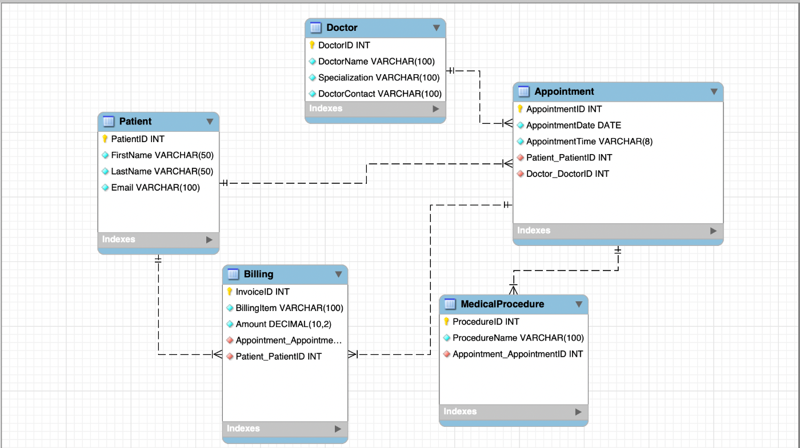
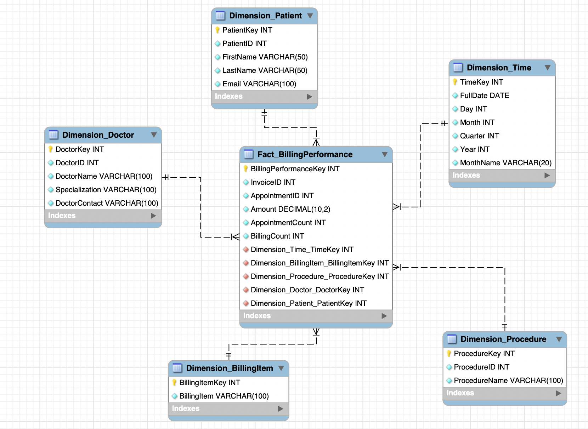
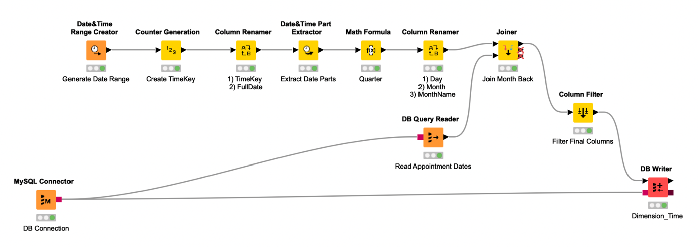
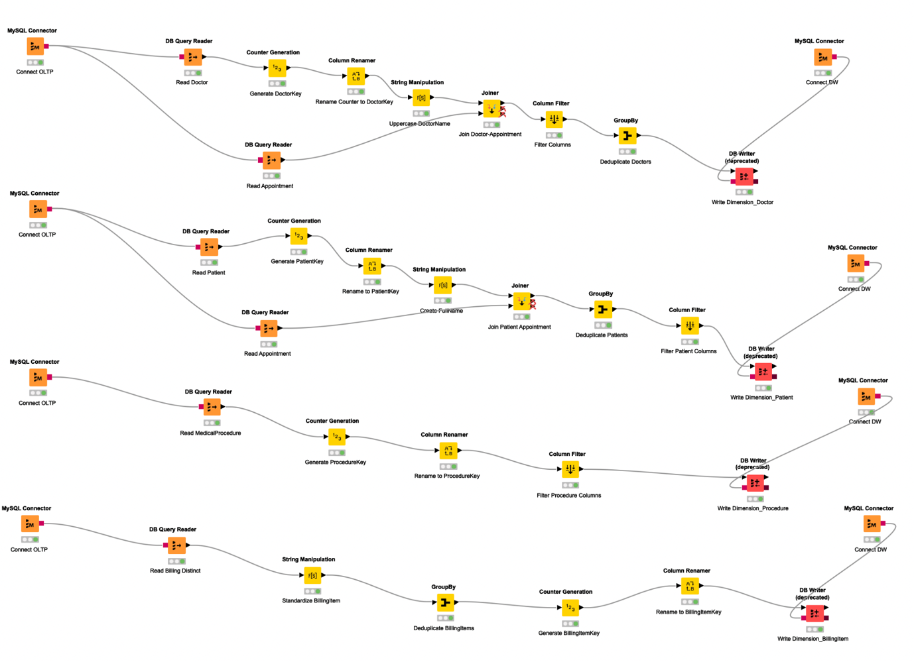
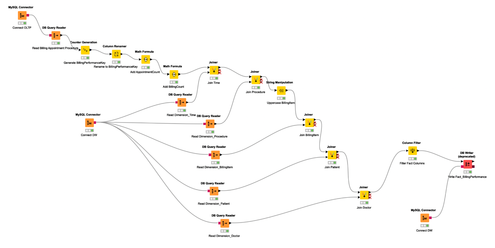
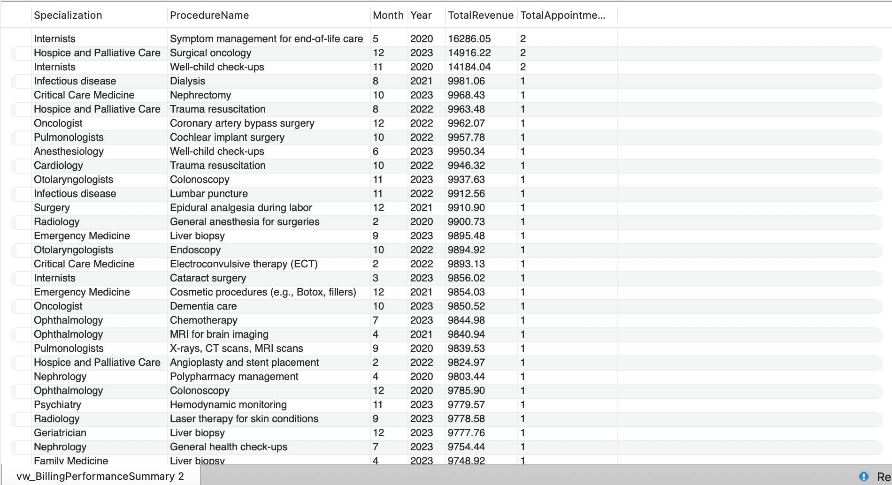
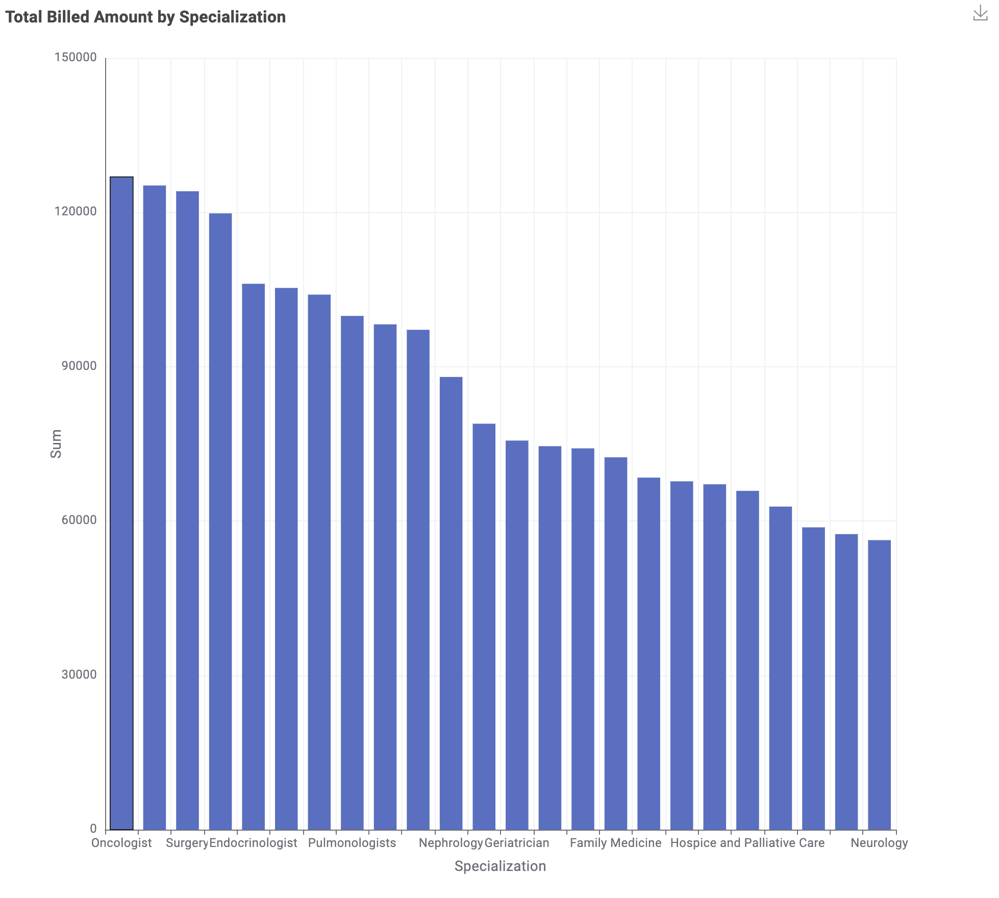

# Healthcare Clinic Billing Performance – Data Warehouse

A star-schema data warehouse for a (fictional) healthcare clinic network, built to monitor **billing performance by medical procedure, doctor specialization and time period**. Group project for *Business Intelligence for Data Science* (MSc Data Science, Tilburg University, spring 2026).

**Stack:** MySQL · MySQL Workbench · KNIME Analytics Platform · SQL

## Business questions
- Which doctor specializations generate the most billed revenue?
- Which medical procedures are billed most frequently?
- How does billing activity change across months and years?

These insights help the clinic plan doctor capacity, allocate resources to procedures and anticipate busy and quiet periods.

## 1. Source database (OLTP)
Five operational tables, loaded into MySQL from CSV in this order: `Patient` → `Doctor` → `Appointment` → `MedicalProcedure` → `Billing`.

- A patient has one or more appointments and billings
- A doctor has one or more appointments
- An appointment has one or more medical procedures and billings

SQL: [`schema/oltp_schema.sql`](schema/oltp_schema.sql)

## 2. Data warehouse – star schema
`Fact_BillingPerformance` sits at the centre, surrounded by five flat dimensions.

| Dimension | Purpose |
|---|---|
| `Dimension_Patient` | Who the patient is |
| `Dimension_Doctor` | Attending doctor and specialization |
| `Dimension_Time` | When the billing happened (derived from appointment dates) |
| `Dimension_BillingItem` | What was billed |
| `Dimension_Procedure` | Which procedure was performed |

**Measures**
- `Amount` – billed amount per billing record (revenue)
- `AppointmentCount` – workload / capacity usage
- `BillingCount` – billing activity and administrative workload

`Amount` shows *how much* was billed; the two counts help explain *why* it is high or low (many appointments, many invoice lines, or expensive procedures).

SQL: [`schema/dw_schema.sql`](schema/dw_schema.sql)

## 3. ETL in KNIME
Three KNIME workflows load the warehouse. Dimensions are loaded first, then the fact table is built by joining the OLTP data to the dimensions and replacing source IDs with surrogate keys.

| Order | Workflow | What it does |
|---|---|---|
| 1 | [`Healthcare_Dimension_Time_final.knwf`](etl/Healthcare_Dimension_Time_final.knwf) | Builds `Dimension_Time` (day, month, quarter, year) from appointment dates |
| 2 | [`Healthcare_Dimension_Tables_final.knwf`](etl/Healthcare_Dimension_Tables_final.knwf) | Cleans and loads the Patient, Doctor, Procedure and BillingItem dimensions |
| 3 | [`Healthcare_Fact_BillingPerformance_final.knwf`](etl/Healthcare_Fact_BillingPerformance_final.knwf) | Joins Billing, Appointment and MedicalProcedure, looks up the dimension keys and writes `Fact_BillingPerformance` |
| – | [`Report_BillingPerformance_final.knwf`](etl/Report_BillingPerformance_final.knwf) | Reads the fact table and charts revenue by specialization |

**Time dimension**

**Other dimensions**

**Fact table**

> **Running the workflows:** import them in KNIME via *File → Import KNIME Workflow*. They connect to a local MySQL server (`localhost:3306`, databases `healthcare_clinic_oltp` and `healthcare_clinic_dw`). Saved passwords have been removed, so enter your own in each *MySQL Connector* node.

## 4. Reporting view (MySQL)
[`schema/vw_BillingPerformanceSummary.sql`](schema/vw_BillingPerformanceSummary.sql) returns total revenue and appointments per specialization, procedure and month.

## 5. Report – revenue by specialization

Oncology, surgery and endocrinology bill the most (each ~120k+ billed), while neurology and a few other specializations sit around 55–60k – roughly a 2× spread between the top and bottom.

## My contributions
This was a group project. My part covered the dimension ETL in KNIME, loading the warehouse in MySQL and the reporting on top of it:

- **Time dimension ETL (KNIME):** built the workflow that generates `Dimension_Time` from the appointment dates: day, month, month name, quarter and year, with a surrogate `TimeKey`, and loads it into MySQL.
- **Dimension tables ETL (KNIME):** built the workflow that extracts patients, doctors, procedures and billing items from the OLTP database, cleans them (trimming and standardising text, removing duplicates), adds surrogate keys and loads them into `Dimension_Patient`, `Dimension_Doctor`, `Dimension_Procedure` and `Dimension_BillingItem` in the MySQL warehouse.
- **Reporting view (MySQL):** wrote `vw_BillingPerformanceSummary`, which joins the fact table to the doctor, procedure and time dimensions to show revenue and appointments per specialization, procedure and month.
- **Report workflow (KNIME):** built [`Report_BillingPerformance_final.knwf`](etl/Report_BillingPerformance_final.knwf), which joins `Fact_BillingPerformance` with `Dimension_Doctor` in the warehouse, sums the billed amount per specialization, sorts the result and shows it as a bar chart.

## Repository contents
| Folder | Contents |
|---|---|
| `schema/` | `oltp_schema.sql`, `dw_schema.sql` and the reporting view `vw_BillingPerformanceSummary.sql` |
| `etl/` | Four KNIME workflows (`.knwf`): three ETL + one report |
| `data/` | Five source CSVs (fictional, generated data) |
| `images/` | Schema diagrams, workflow screenshots, report chart |
| `docs/` | Full project report |

## The data
The dataset is **fictional and generated** – no real patients or doctors. Five CSV files in [`data/`](data/), 1,000 rows each:

| File | Columns |
|---|---|
| `Patient_final.csv` | PatientID, FirstName, LastName, Email |
| `Doctor_final.csv` | DoctorID, DoctorName, Specialization, DoctorContact |
| `Appointment_final.csv` | AppointmentID, AppointmentDate, AppointmentTime, PatientID, DoctorID |
| `MedicalProcedure_final.csv` | ProcedureID, ProcedureName, AppointmentID |
| `Billing_final.csv` | InvoiceID, AppointmentID, PatientID, BillingItem, Amount |

Appointments run from January 2020 to December 2023.

## Team
This was a group project
